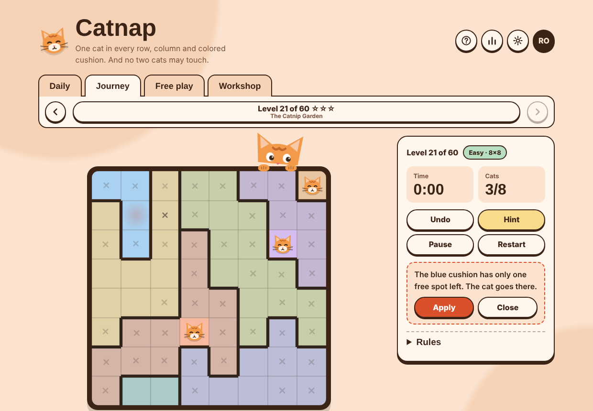

# 🐱 Catnap

A cozy logic puzzle with cats that runs right in your browser. No install, no dependencies, no build step.
Available in **English** and **Romanian** (*Mustăți*).

**▶ Play: https://alexc0906.github.io/catnap-puzzle/**



## Rules

The N×N board is split into N colored cushions. Place N cats so that:

1. every **row** has exactly one cat;
2. every **column** has exactly one cat;
3. every **colored cushion** has exactly one cat;
4. **no two cats touch**, not even diagonally.

Every puzzle has exactly one solution and can be solved with pure logic. You never need to guess.

## Game modes

| Mode | What it is |
|---|---|
| **Daily** | One puzzle per day, the same for everyone. Easy on Monday, Expert on Sunday. Keep your streak going 🔥 Missed a day? Play it from the archive calendar. |
| **Journey** | 60 levels in 6 chapters, from *The Yarn Basket* (5×5 Easy) to *Moonlit Rooftops* (10×10 Expert). Earn up to 3 stars per level. The first levels teach you as you play. |
| **Free play** | Endless puzzles. Pick any difficulty (Easy, Medium, Hard, Expert) and board size (5×5 to 10×10). |
| **Marathon** | 5 minutes on the clock. Every solve gives points and +15 s, hints cost 20 s. Boards grow as you go. Beat your best score. |
| **Workshop** | Paint your own puzzle. Live checks tell you if it has exactly one solution and how hard it is. Share it as a link. |

## Features

- **Explained hints**: a hint doesn't just reveal a cell. It tells you *why*, e.g. “Every free spot in the yellow cushion is on row 3, so the rest of row 3 gets ×”, and highlights the cells involved.
- **Coach mode**: explains every next step automatically, great for learning.
- **Shareable image card**: after a win, get a PNG of your solved board with your cat, time and stars, ready for WhatsApp or Instagram.
- **Calm lo-fi music**, generated live in the browser (optional), and a little chime when a cushion gets its cat.
- **A mascot cat** peeks over the board: it follows your pointer, gets scared by conflicting cats, dozes off when you pause and celebrates when you win.
- **22 achievements**, from *First nap* to *Night owl* and *Cheetah* (10×10 in under 5 minutes, no hints).
- **8 cats to unlock** (Ginger, Tabby, Coal, Tuxedo, Calico, Siamese, Snow, Galaxy) with Journey stars and daily streaks.
- Statistics: puzzles solved, streaks, best time for every size and difficulty.
- Synthesized sound effects (Web Audio, no audio files), including a little meow.
- Undo and redo, pause, auto-× around cats, mistake highlighting, color-blind labels.
- Shareable links for every puzzle, plus a copyable result.
- Light and dark theme, works great on phones, **installable and playable offline** (PWA).

## Controls

| Action | Mouse / touch | Keyboard |
|---|---|---|
| Place × | one tap | `X` |
| Place a cat | two taps (or right-click) | `C` |
| Several × at once | drag across cells | |
| Move around the board | | arrow keys |
| Undo | Undo button | `Z` / `Ctrl+Z` |
| Redo | | `Shift+Z` / `Ctrl+Y` |
| Hint | Hint button | `H` |
| Pause | Pause button | `P` |

## How it works

**Generator** (`src/engine.js`)
1. Randomly place N cats that follow the rules (backtracking).
2. Grow N cushions outward from each cat (random flood fill).
3. A brute-force solver counts solutions. If it finds a second one, a cell is moved between cushions to rule it out, then it checks again.

**Logic solver** (`src/logic.js`) solves the puzzle the way a person would, one deduction at a time:

| Technique | Idea | Difficulty |
|---|---|---|
| Single | A row, column or cushion has only one free cell left | Easy |
| Confine | A cushion fits in one row/column, or a row/column fits in one cushion | Medium |
| Blocker | A cat on this cell would leave some row, column or cushion empty | Medium |
| Subset | k cushions fit in k rows/columns (or the reverse) | Hard |
| Contradiction | Trying a cat here leads to a dead end a few steps later | Expert |

The hardest technique a puzzle needs decides its difficulty. The same solver powers the explained hints. Everything is seeded, so the same seed always gives the same puzzle; that is how the daily puzzle is the same for everyone. Generation runs in a Web Worker so the page never freezes.

## Project structure

```
index.html            page markup and dialogs
style.css             all styles (light + dark theme, cat skins)
src/engine.js         seeded RNG, brute-force solver, generator
src/logic.js          human-style logic solver, difficulty rating
src/levels.js         the 60 Journey levels (generated)
src/game.js           game UI, modes, hints, workshop, mascot, progress
src/achievements.js   Journey chapters and achievements
src/i18n.js           English + Romanian strings
src/audio.js          synthesized sound effects
src/music.js          procedural background music
src/worker.js         background puzzle generation
scripts/build-levels.js   regenerates src/levels.js
sw.js, manifest.webmanifest   offline support / install
test/                 Node tests
```

## Development

```bash
npm test               # run all tests
npm run build:levels   # regenerate the Journey levels
```

To play locally, serve the folder with any static server (for example `python3 -m http.server`) and open it in a browser. Opening `index.html` directly also works.

The tests check, for every size and difficulty, that puzzles are valid, have exactly one solution, can be solved by logic alone, and that every logic step is correct. CI runs them on every push.

## License

MIT
